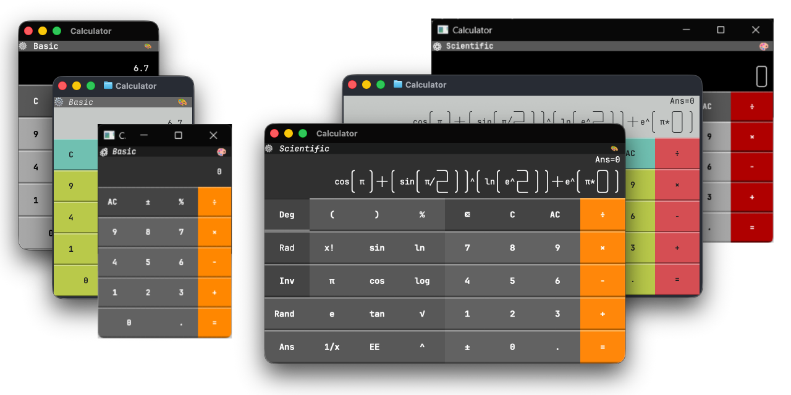

# Incredible Calculator

A TUI calculator that works as a terminal app, macOS app, Windows app and in the browser. Has two modes: a pocket-style **Basic** keypad and a full **Scientific** one.

<p align=center>

## What's Incredible About It?

Nothing actually. 

It is common for UI frameworks to have a demo calculator. This one is built using the [Incredible](https://www.incredible.rs/) TUI framework, hence it is called "Incredible Calculator".

# Install

## Web

No install needed: https://ronilan.github.io/incredible-calculator/

## Native binaries

Prebuilt binaries are provided for each [release](https://github.com/ronilan/incredible-calculator/releases).

## TUI Install / Uninstall

Installs the latest release binary as the `calculator` command into `/usr/local/bin` (macOS/Linux) or a folder under `C:\Program Files` (Windows).

```bash
curl --proto '=https' --tlsv1.2 -sSf https://raw.githubusercontent.com/ronilan/incredible-calculator/main/install.sh | bash
```

```powershell
irm https://raw.githubusercontent.com/ronilan/incredible-calculator/main/install.ps1 | iex
```

Uninstall the same way with `uninstall.sh` / `uninstall.ps1`.

## Linux via Docker

To try the Linux terminal version, fetch the repository's `Dockerfile` and build the image (it downloads the latest Linux release, so no source checkout is needed):

```bash
mkdir docker-build && cd docker-build
curl -fsSL https://raw.githubusercontent.com/ronilan/incredible-calculator/main/Dockerfile -o Dockerfile
docker build -t incredible_calculator .
docker run --rm -it incredible_calculator
```

Run the commands in an **empty folder** (not your home directory) so Docker's build context doesn't include large/system folders like `~/.Trash`.

Type `calculator` in the container shell to launch.


# Use

The title bar has two controls. **⚙** switches between the Basic and Scientific calculators, and **🎨** cycles the colour theme (or press `T`). Switching modes starts the new calculator fresh; the theme is kept. In the native apps, the theme, calculator mode and angle setting are remembered for the next launch.

## Basic

A pocket calculator: each operator resolves the pending calculation as you go, so `2 + 3 × 4 =` gives `20` rather than `14`. It has `AC`, `±` and `%`.

## Scientific

Full operator precedence, parentheses and a history line above the display. Extra keys provide powers, square and nth roots, factorials, `log` / `ln`, trigonometry in **Deg** or **Rad**, `π` and `e`, `Ans`, `1/x`, `%`, `±`, `EE` and `Rand`. **Inv** swaps the function keys for their inverses (`sin⁻¹`, `cos⁻¹`, `tan⁻¹`, `x²`, `eˣ`, `10ˣ`, `ʸ√x`).

Adjacent values multiply implicitly, so `4π`, `2(3+4)` and `√(4π)` work without typing `×`.

Pasting (Scientific only) replaces the expression with the clipboard text: line breaks and unsupported characters are dropped, and common notation such as `pi`, `sqrt(9)`, `5!`, `50%` and `1e3` is converted to the keypad's form.

`⌫` removes the last entry (a function call such as `cos(` goes as one unit), `C` clears the value being typed, and `AC` starts over, including the stored answer that `Ans` refers to.

## Controls

| Key | Action |
| --- | --- |
| `0`–`9`, `.` | Type a number |
| `+` `-` `*` `/` | Operators |
| `^` | Power (Scientific) |
| `(` `)` | Parentheses (Scientific) |
| `=` / `Enter` | Evaluate |
| `%` | Percent |
| `Ctrl`+`S` | Change sign |
| `Delete` | Backspace in Scientific; `AC` / `C` clear in Basic |
| `Ctrl`+`Delete` | Clear entry (Scientific) |
| `Esc` | Clear all (Scientific) |
| `r` | Random number (Scientific) |
| `a` | `Ans` (Scientific) |
| `i` | `Inv` (Scientific) |
| `x` | `1/x` (Scientific) |
| `E` | `EE` (Scientific) |
| `p` / `e` | `π` / `e` (Scientific) |
| `s` / `c` / `t` | `sin` / `cos` / `tan` (Scientific) |
| `l` / `n` | `log` / `ln` (Scientific) |
| `q` / `!` | Square root / factorial (Scientific) |
| `d` | Toggle `Deg` / `Rad` (Scientific) |
| `T` | Cycle theme |
| Mouse | Click any button |

Scientific-only letter shortcuts are unshifted. The uppercase `E` for `EE` needs `Shift`+`e`, and the theme needs `Shift`+`t`. Every keypad button has a key.

## Files

The native apps save one small preferences file: the chosen theme, the calculator mode and the angle setting. It lives in the platform's per-user data directory:

- **macOS**: `~/Library/Application Support/incredible-calculator/.incredible-calculator`
- **Linux**: `${XDG_DATA_HOME:-~/.local/share}/incredible-calculator/.incredible-calculator`
- **Windows**: `%APPDATA%\incredible-calculator\.incredible-calculator`

Calculations are never written to disk. If the file is missing or damaged, the app starts with the defaults: Apple theme, Basic calculator, `Deg`.

# Development

See [Development](./markdowns/DEVELOPMENT.md) and [Development Environment Prerequisites](./markdowns/DEVELOPMENT_PREREQUISITES.md)

---

*Fabriqué au Canada : Made in Canada 🇨🇦*
